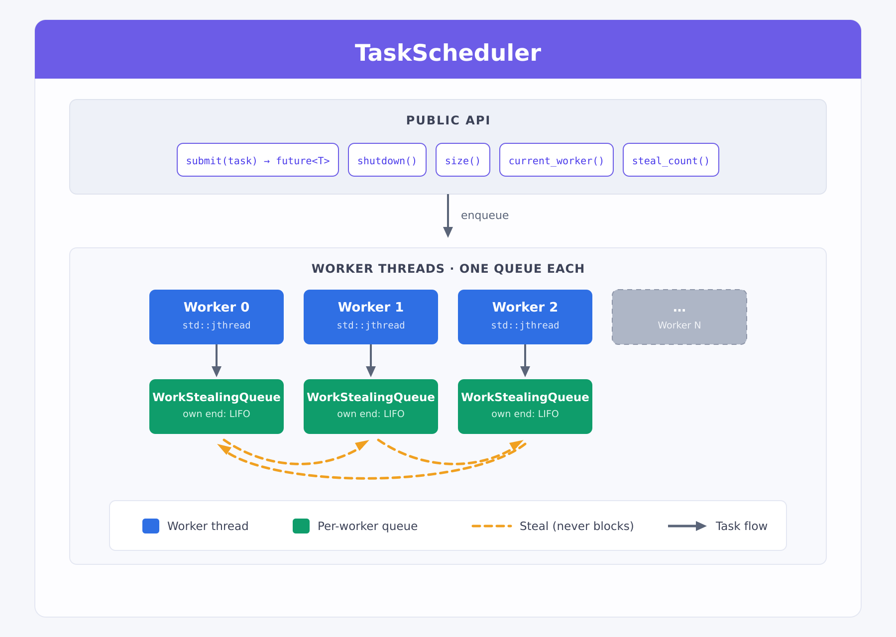
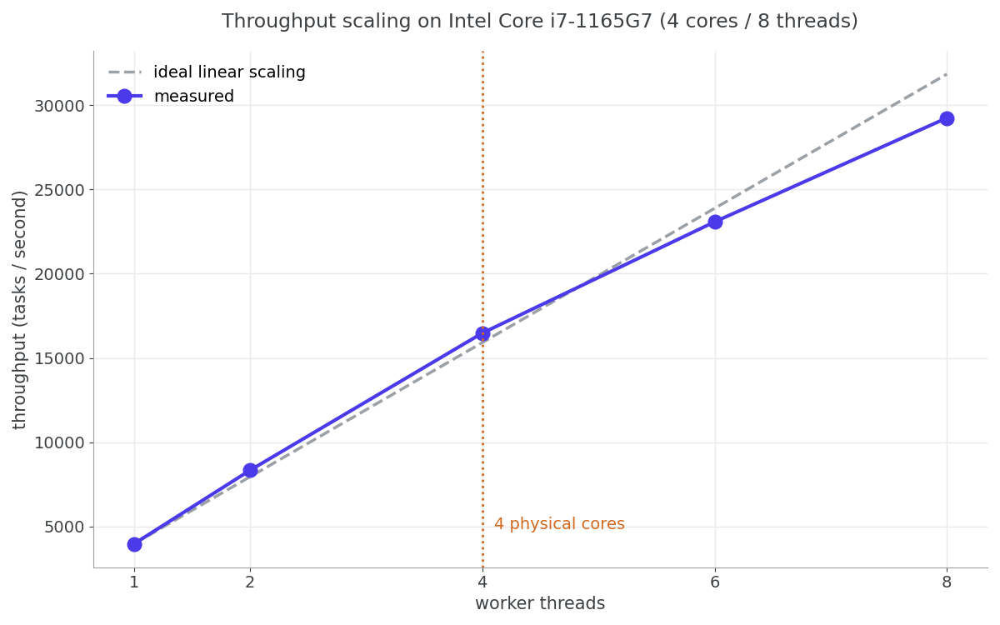
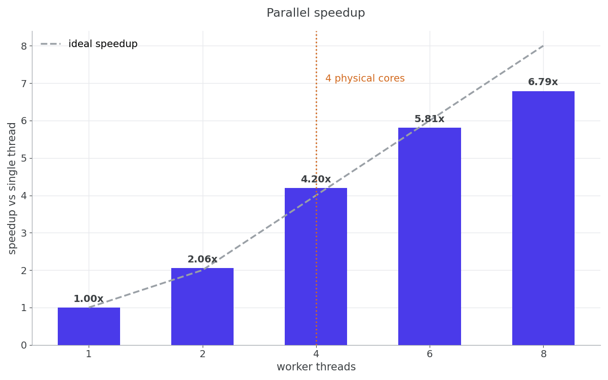

# cpp-work-stealing-scheduler

A work-stealing task scheduler written in modern C++20.


Submit any callable, get a `std::future` back, and let a pool of worker threads
run tasks in parallel — each worker drawing from its own queue and stealing from
others when it runs out of work.

## Architecture



The pool runs N worker threads, **each with its own task queue**. A worker takes
work from its own queue (LIFO, keeping recently-created work hot in cache) and,
when that queue runs dry, steals a task from another worker's queue (from the
opposite end, FIFO). Each queue has its own lock, so workers only contend on a
lock when they touch the same queue — and a thief never waits on that lock: if
the owner holds it, the thief moves on to the next victim.

## Features

- **Work-stealing scheduler** — per-worker queues with stealing for load balancing.
- **Futures** — `submit()` returns a `std::future<T>`; both results and exceptions
  propagate back to the caller.
- **Modern C++20** — `std::jthread`, `std::stop_token`, and a stop-token-aware
  condition-variable wait for cooperative cancellation.
- **Graceful shutdown** — queued tasks are drained before workers exit; threads
  join automatically via RAII, or explicitly via `shutdown()`.
- **Observability** — `current_worker()` and `steal_count()` for introspection.
- **Tested** — unit tests run through CTest, and CI runs the suite under
  ThreadSanitizer and Address/UndefinedBehavior sanitizers (all clean).
  Concurrent submission is covered by 8 producer threads submitting 8000 tasks,
  each asserted to run exactly once.

## Quick start

Requires CMake 3.20+ and a C++20 toolchain with `std::jthread` and
`std::stop_token`: GCC 11+, or Clang with libstdc++. libc++ only gained
`std::jthread` in LLVM 18, so Clang paired with libc++ needs that or newer.
CI builds with GCC on Ubuntu.

```bash
cmake -S . -B build
cmake --build build
```

Run the demo (squares computed in parallel):

```bash
./build/demo
```

Watch work-stealing happen live, colour-coded per worker:

```bash
./build/visual_demo
```

Run the tests:

```bash
ctest --test-dir build --output-on-failure
```

## Usage

```cpp
#include "task_scheduler/task_scheduler.hpp"

ts::TaskScheduler pool(4);

auto future = pool.submit([] { return 6 * 7; });
int result = future.get();   // 42
```

`submit` accepts any callable and returns a `std::future` of its result type.
If a task throws, the exception is re-thrown when you call `.get()`.

The pool can also be asked what it is doing, which is mostly useful in tests
and demos:

```cpp
pool.size();          // number of worker threads
pool.steal_count();   // tasks taken from another worker's queue so far

// Inside a task, which worker is running it:
pool.submit([&pool] { return pool.current_worker(); });

// Outside the pool, there is no answer:
pool.current_worker() == ts::TaskScheduler::no_worker;   // true on main
```

The destructor drains queued work and joins the workers. Call `shutdown()` if
you want that to happen while the pool object is still alive; afterwards
`submit` from outside the pool throws rather than handing back a future that
would never become ready.

## Using it in your project

The build installs a `ts::task_scheduler` target with a CMake package config,
so a consuming project can pull it in three ways.

Already installed somewhere:

```cmake
find_package(task_scheduler 1.0 REQUIRED)
target_link_libraries(your_app PRIVATE ts::task_scheduler)
```

Fetched at configure time, with no separate install step:

```cmake
include(FetchContent)
FetchContent_Declare(task_scheduler
    GIT_REPOSITORY https://github.com/zenith19/cpp-work-stealing-scheduler.git
    GIT_TAG        main)
FetchContent_MakeAvailable(task_scheduler)
target_link_libraries(your_app PRIVATE ts::task_scheduler)
```

Or vendored as a subdirectory:

```cmake
add_subdirectory(third_party/cpp-work-stealing-scheduler)
target_link_libraries(your_app PRIVATE ts::task_scheduler)
```

Either of the last two builds the library alone — the demos, benchmark and
tests are skipped unless this is the top-level project, or you set
`-DTASK_SCHEDULER_BUILD_EXTRAS=ON`.

To install it yourself:

```bash
cmake -S . -B build -DCMAKE_BUILD_TYPE=Release
cmake --build build
cmake --install build --prefix /your/prefix
```

## Benchmarks

4000 CPU-bound tasks spread across a growing pool, ten runs per worker count
with the median reported and the slowest and fastest run shown alongside it.
The hardware, compiler and full table live in
[docs/results.md](docs/results.md) — `scripts/run_benchmarks.sh` regenerates
that file and these two charts from the same run, so they cannot disagree.





Throughput tracks the ideal line closely through the 4 physical cores, then
keeps climbing with diminishing returns across all 8 hardware threads. The
error bars are the slowest and fastest of the ten runs: tight while the pool
fits in physical cores, wide once it does not, as sustained all-core turbo
clocks fall away.

To reproduce — this regenerates `docs/results.md` and both charts from one
benchmark run, so the table and the pictures cannot drift apart:

```bash
./scripts/run_benchmarks.sh
```

It needs `python3` with `matplotlib`. Pass `--cpu` / `--cores` / `--threads`
when publishing numbers measured on different hardware.

## Design notes

- **Work-stealing, not lock-free.** Each queue is guarded by its own mutex.
  Work-stealing (the scheduling strategy) and lock-free (the synchronisation
  mechanism) are independent concerns. Per-queue locking was chosen because it
  is straightforward to reason about and verify; it has not been benchmarked
  against a lock-free deque (e.g. Chase–Lev), which would be a natural next step.
- **Blocking inside tasks.** Like any fixed-size pool, blocking inside a task
  while waiting on other tasks from the same pool can deadlock if every worker
  blocks at once. Submit independent work, or collect results from outside the
  pool.
- **Shutdown drains.** The destructor lets workers finish all queued tasks
  before exiting, rather than discarding pending work.
- **Benchmark scope.** The benchmark measures scaling against a 1-worker run of
  this scheduler. It does not yet compare against a single shared-queue pool or
  `std::async`.
- **Benchmark noise.** The single-worker baseline is stable, but the
  hyper-threaded figures move by 10-20% between runs on thermally-constrained
  hardware as all-core turbo clocks settle. Read those rows as a range.
- **Idle workers don't poll.** A worker with no work blocks on a condition
  variable until a task is enqueued, rather than waking periodically to scan
  the queues. An idle 8-worker pool burns no measurable CPU. Enqueue only
  touches that condition variable when a worker is actually asleep, so the
  busy path stays on the per-queue locks alone.

## Roadmap

- Benchmark a lock-free Chase–Lev deque against the per-queue-mutex design.
- Add `std::async` and single-shared-queue baselines to the benchmark, so the
  numbers compare against something other than this scheduler's own 1-worker run.
- Interleave benchmark repetitions across worker counts, rather than running all
  repetitions of one worker count together, to spread thermal drift evenly.
- `shutdown_now()` — stop and discard pending work, alongside the draining
  `shutdown()` that exists today.

## Project layout

```
include/task_scheduler/   public headers (scheduler + work-stealing queue)
src/                      implementation, demo, visual demo
tests/                    unit tests (CTest)
benchmarks/               throughput benchmark
docs/                     architecture diagram, benchmark charts, results
scripts/                  benchmark runner + chart generation
cmake/                    package config template for find_package()
.github/workflows/        CI: build, ThreadSanitizer, Address/UB sanitizer
```

## License

MIT — see [LICENSE](LICENSE).
